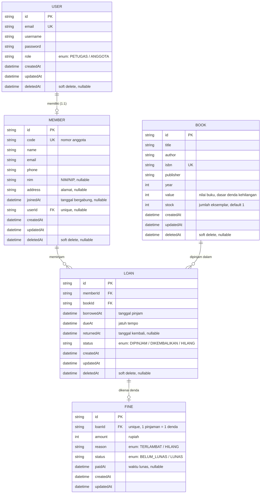

# ERD — Sistem Perpustakaan

> **ERD (Entity Relationship Diagram)**: cetak biru struktur database yang memetakan tabel, kolom, dan relasinya.
> Dokumen ini menjadi acuan sebelum `prisma/schema.prisma` ditulis.
>
> **Catatan:** path endpoint yang disebut di bawah bersifat konseptual dan relatif terhadap
> prefix **`/api/v1`** (kecuali `GET /`) — lihat [`docs/api.md`](./api.md) untuk URL lengkap.

## Diagram

## Entitas

### 1. `USER` — akun untuk login

| Kolom                         | Tipe      | Keterangan                                      |
| ----------------------------- | --------- | ----------------------------------------------- |
| `id`                        | uuid      | PK                                              |
| `email`                     | string    | unique, dipakai saat login                      |
| `username`                  | string?   | opsional                                        |
| `password`                  | string    | hash bcrypt                                     |
| `role`                      | enum      | `PETUGAS` (admin) atau `ANGGOTA` (peminjam) |
| `createdAt` / `updatedAt` | datetime  | audit otomatis                                  |
| `deletedAt`                 | datetime? | soft delete                                     |

### 2. `MEMBER` — data anggota perpustakaan

| Kolom                            | Tipe      | Keterangan                                                             |
| -------------------------------- | --------- | ---------------------------------------------------------------------- |
| `id`                           | uuid      | PK                                                                     |
| `code`                         | string    | unique — nomor anggota (mis. `AGT-0001`)                            |
| `name` / `email` / `phone` | string    | identitas anggota                                                      |
| `nim`                      | string?   | NIM/NIP — ID institusi (kampus/kantor), nullable                       |
| `address`                  | string?   | alamat peminjam                                                        |
| `joinedAt`                 | datetime? | tanggal bergabung (default `now`), nullable untuk petugas              |
| `userId`                       | uuid?     | FK → `USER`, unique — terisi otomatis saat `POST /auth/register` |
| `deletedAt`                    | datetime? | soft delete                                                            |

> Anggota yang mendaftar sendiri otomatis punya `User` (role `ANGGOTA`). Anggota manual
> (diinput petugas) bisa tanpa `User` (kolom `userId` nullable).

### 3. `BOOK` — katalog buku

| Kolom                    | Tipe         | Keterangan                                                              |
| ------------------------ | ------------ | ----------------------------------------------------------------------- |
| `id`                   | uuid         | PK                                                                      |
| `title` / `author`   | string       | judul & penulis                                                         |
| `isbn`                 | string       | unique                                                                  |
| `publisher` / `year` | string / int | penerbit & tahun terbit                                                 |
| `value`                | int          | nilai buku dalam rupiah — dasar perhitungan **denda kehilangan** |
| `stock`                | int          | jumlah eksemplar tersedia, default `1`                                |
| `deletedAt`            | datetime?    | soft delete                                                             |

### 4. `LOAN` — transaksi peminjaman (1 pinjaman = 1 buku)

| Kolom          | Tipe      | Keterangan                                      |
| -------------- | --------- | ----------------------------------------------- |
| `id`         | uuid      | PK                                              |
| `memberId`   | uuid      | FK → `MEMBER`                                |
| `bookId`     | uuid      | FK → `BOOK`                                  |
| `borrowedAt` | datetime  | tanggal pinjam (default `now`)                |
| `dueAt`      | datetime  | jatuh tempo — sumber perhitungan keterlambatan |
| `returnedAt` | datetime? | terisi saat pengembalian                        |
| `status`     | enum      | `DIPINJAM`, `DIKEMBALIKAN`, `HILANG`      |
| `deletedAt`  | datetime? | soft delete                                     |

### 5. `FINE` — denda (keterlambatan / kehilangan)

| Kolom      | Tipe      | Keterangan                                                                 |
| ---------- | --------- | -------------------------------------------------------------------------- |
| `id`     | uuid      | PK                                                                         |
| `loanId` | uuid      | FK → `LOAN`, **unique** — satu pinjaman paling banyak satu denda |
| `amount` | int       | nominal rupiah                                                             |
| `reason` | enum      | `TERLAMBAT` atau `HILANG`                                              |
| `status` | enum      | `BELUM_LUNAS` (default) atau `LUNAS`                                   |
| `paidAt` | datetime? | terisi saat petugas menandai lunas                                         |

## Relasi

| Relasi                 | Card.    | Keterangan                                                           |
| ---------------------- | -------- | -------------------------------------------------------------------- |
| `USER` → `MEMBER` | 1 : 0..1 | 1 akun maksimal 1 data anggota (akun petugas tidak punya `Member`) |
| `MEMBER` → `LOAN` | 1 : N    | 1 anggota bisa banyak pinjaman                                       |
| `BOOK` → `LOAN`   | 1 : N    | 1 judul dipinjam berkali-kali (per transaksi)                        |
| `LOAN` → `FINE`   | 1 : 0..1 | denda hanya ada kalau telat/hilang                                   |

> Cek "apakah anggota masih punya denda?" dilakukan lewat jalur `MEMBER → LOAN → FINE`
> (`fine.status = BELUM_LUNAS`), tanpa perlu kolom `memberId` tambahan di `FINE`.

## Strategi Tampilan Data (Join di API)

Identitas orang **tidak diduplikasi** ke `USER` — nama, telepon, NIM/NIP, alamat, dan
kode anggota hanya tersimpan di `MEMBER` sebagai satu-satunya sumber kebenaran. Saat
petugas membutuhkannya, data di-join pada response API:

| Endpoint | Join |
|---|---|
| `GET /members` | → `user: { email, username, role }` |
| `GET /loans` | → `member: { name, code, phone, nim }`, `book: { title, isbn, value }` |
| `GET /fines` | → `loan.member: { name, code }`, `loan.book: { title }` |
| `GET /auth/me` | → `member: { ... }` (jika role `ANGGOTA`) |

Dengan begini petugas/pemilik perpustakaan langsung mengenali identitas asli peminjam
tanpa menebak-nebak username, dan tanpa risiko data ganda yang bisa beda sendiri
(nama di satu tabel ≠ nama di tabel lain).

## Aturan Bisnis

1. **Pinjam** — `POST /loans` ditolak (`409`) jika anggota punya `Fine` berstatus
   `BELUM_LUNAS`, atau `Book.stock = 0`. Jika lolos: `stock` dikurangi.
2. **Pengembalian tepat waktu** — `PATCH /loans/:id/return` → `status = DIKEMBALIKAN`,
   `returnedAt = now`, `stock` dikembalikan. Tidak ada denda.
3. **Pengembalian telat** — hari keterlambatan = selisih `dueAt` → `returnedAt`
   (dibulatkan ke atas). Otomatis dibuat `Fine{ reason: TERLAMBAT, amount: hari × FINE_PER_DAY }`.
4. **Kehilangan buku** — `PATCH /loans/:id/lost` → `status = HILANG`, `stock` **tidak**
   dikembalikan, dibuat `Fine{ reason: HILANG, amount: Book.value }`.
5. **Pelunasan** — manual: petugas `PATCH /fines/:id/pay` → `status = LUNAS`,
   `paidAt = now`. Blokir pinjam terbuka otomatis begitu tidak ada denda `BELUM_LUNAS`.
6. **Soft delete & restore** — hapus hanya mengisi `deletedAt`; `PATCH …/:id/restore`
   mengosongkannya (`409` bila tidak sedang terhapus). Data terhapus dilihat via
   `GET …?deleted=true`.

## Catatan Desain

- **Tarif denda/hari** tidak disimpan di database, tapi di `.env`:
  `FINE_PER_DAY=1000` (rupiah) — ganti tarif tanpa ubah kode atau migrasi.
- **Soft delete** (`deletedAt`) dipakai di `User`, `Member`, `Book`, `Loan` agar riwayat
  transaksi tidak hilang; `Fine` tidak di-soft-delete karena menyangkut keuangan.
  Data terhapus tidak permanen — bisa dikembalikan (`PATCH …/:id/restore`) dan terlihat
  di `GET …?deleted=true`.
- **Hapus anggota cascade ke `User`** — `DELETE /members/:id` mengisi `deletedAt` anggota
  **dan** akun login-nya dalam satu transaksi, supaya anggota terhapus tidak bisa login
  lagi (tidak ada akun "setengah mati"). `PATCH /members/:id/restore` mengaktifkan
  keduanya. Tanpa ini, kolom `User.deletedAt` tidak akan pernah terisi.
- Seluruh `id` memakai `uuid()` agar konsisten dengan pola `User` yang sudah ada.
- 1 pinjaman = 1 buku (keputusan fase ini). Jika nanti butuh pinjam banyak buku sekaligus,
  cukup tambah tabel pivot `LoanItem` antara `LOAN` dan `BOOK`.
