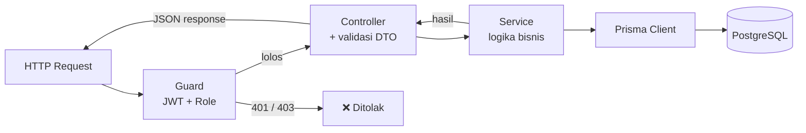

# Struktur Project & Separation of Concerns (SOC)

> Dokumen ini menjelaskan tanggung jawab setiap folder/file, serta aturan pemisahan
> tanggung jawab yang dipakai di seluruh codebase. Acuan: [`docs/prd.md`](./prd.md) &
> [`docs/erd.md`](./erd.md).

## Pohon Folder (annotasi)

```
simple-crud/
├── docs/                        	Dokumentasi proyek
│   ├── prd.md                      Kebutuhan produk: fitur + alasannya
│   ├── erd.md                      Struktur database & relasi
│   ├── structure.md                Dokumen ini
│   ├── testing.md                  Panduan testing: pola, resep, aturan
│   └── test-report.md              Laporan hasil run: 70/70 + coverage
│
├── src/                         	 Sumber kode aplikasi
│   ├── main.ts                      Bootstrap: helmet, port, inisialisasi app
│   ├── app.module.ts                Root module — mendaftarkan semua module fitur
│   ├── app.controller.ts            Endpoint GET / (hello) — contoh bawaan
│   ├── app.service.ts               Logika endpoint hello
│   ├── generated/                   Output Prisma client — jangan diedit manual
│   ├── common/                      Lintas modul: prisma/, guards/, decorators/, types/
│   ├── auth/                        Register/login/me, JWT (JwtModule global), DTO auth
│   ├── books/                       CRUD katalog buku
│   ├── members/                     🔨 CRUD anggota (identitas peminjam)
│   ├── loans/                       🔨 Peminjaman, pengembalian, kehilangan
│   └── fines/                       🔨 Daftar denda & pelunasan
│
├── prisma/                      	 Konfigurasi database
│   ├── schema.prisma                Model & relasi — sumber kebenaran database
│   └── migrations/                  Hasil `prisma migrate` (dibuat otomatis)
│
├── test/                        	 Test end-to-end (supertest)
│   └── app.e2e-spec.ts
│
├── .env                         Konfigurasi rahasia — TIDAK di-commit
├── prisma.config.ts             Path schema & datasource Prisma
├── nest-cli.json                Konfigurasi build NestJS
├── vitest.config.ts             Konfigurasi test unit
├── vitest.config.e2e.ts         Konfigurasi test e2e
├── oxlint.json                  Konfigurasi linter
└── .prettierrc                  Konfigurasi formatter
```

> 🔨 = folder yang belum dibuat (menyusul di fase berikutnya phase 1).

## Tanggung Jawab per Folder

| Folder / File              | Tanggung jawab                                           | Boleh                                | Tidak boleh                             |
| -------------------------- | -------------------------------------------------------- | ------------------------------------ | --------------------------------------- |
| `src/*/…controller.ts`  | Menerima HTTP, memanggil service, mengembalikan response | Baca DTO, pakai guard/decorator      | Akses Prisma, logika bisnis             |
| `src/*/…service.ts`     | Logika bisnis + akses data via Prisma                    | Buat objek/tipe DTO, throw exception | Tahu soal `Request`/`Response` HTTP |
| `src/*/…dto.ts`         | Bentuk & validasi data masuk (`class-validator`)       | Deklarasi properti + validasi        | Berisi logika bisnis                    |
| `src/common/`            | Potongan lintas modul: guard, decorator, filter          | Dipakai module mana pun              | Berisi logika satu fitur                |
| `src/auth/…strategy.ts` | Verifikasi token JWT                                     | —                                   | Logika pinjam/denda                     |
| `src/generated/`         | Hasil generate Prisma client                             | Dipakai service                      | **Diedit manual**                 |
| `prisma/schema.prisma`   | Definisi model, enum, relasi                             | Diubah + `migrate`                 | Dipanggil dari controller               |
| `test/`                  | Test e2e — uji alur HTTP utuh                           | Import `AppModule`                 | Test logika detail (itu unit test)      |
| `docs/`                  | PRD, ERD, struktur, panduan & laporan testing            | —                                   | —                                      |
| `.env`                   | `DATABASE_URL`, `FINE_PER_DAY`, `PORT`             | Diisi lokal                          | Di-commit ke git                        |

## Aturan SOC

1. **Controller = pintu HTTP saja.** Terima request → validasi DTO → panggil service.
   Tidak ada `PrismaService` di controller.
2. **Service = satu-satunya tempat logika bisnis & akses database.** Service tidak tahu
   soal HTTP — jika perlu error, `throw` exception NestJS (`ConflictException`, dll.),
   lalu filter yang menerjemahkannya ke status code.
3. **Prisma client hanya dipanggil dari service.** Tidak ada `import { PrismaClient }`
   di controller/DTO.
4. **DTO adalah batas data.** Semua input datang lewat DTO yang divalidasi
   (`ValidationPipe` global di `main.ts`).
5. **Satu fitur = satu folder module** (`books/`, `loans/`, …). Controller, service, dan
   DTO sebuah fitur tidak boleh terpisah ke folder lain.
6. **`common/` hanya untuk yang benar-benar dipakai ≥ 2 modul.** Kalau cuma dipakai satu
   fitur, simpan di folder fitur itu.
7. **`src/generated/` dan `prisma/migrations/` = hasil generate.** Ubah lewat
   `schema.prisma` / `prisma migrate`, jangan edit file-nya langsung.

## Alur Sebuah Request



Contoh konkret `POST /loans`:

1. `JwtAuthGuard` + `RolesGuard` memastikan token valid & role `PETUGAS`
2. `LoansController` menerima body → validasi lewat `CreateLoanDto`
3. `LoansService.loan()` cek denda `BELUM_LUNAS` → kalau ada, `throw ConflictException` (409)
4. Service kurangi `stock`, simpan record `Loan` lewat Prisma
5. Controller membungkus hasil jadi JSON 201

## Konvensi Penamaan File

| Pola                                      | Contoh                    | Fungsi                                        |
| ----------------------------------------- | ------------------------- | --------------------------------------------- |
| `*.module.ts`                           | `loans.module.ts`       | Registrasi controller + provider sebuah fitur |
| `*.controller.ts`                       | `loans.controller.ts`   | Route HTTP                                    |
| `*.service.ts`                          | `loans.service.ts`      | Logika bisnis                                 |
| `create-*.dto.ts` / `update-*.dto.ts` | `create-loan.dto.ts`    | Payload masuk                                 |
| `*.strategy.ts`                         | `jwt.strategy.ts`       | Strategi auth                                 |
| `*.spec.ts`                             | `loans.service.spec.ts` | Unit test (menempel di `src/`)              |
| `*.e2e-spec.ts`                         | `loans.e2e-spec.ts`     | E2E test (di `test/`)                       |

Class: `PascalCase` (`LoansService`) · File & variabel: `camelCase` · Konstanta env:
`SCREAMING_SNAKE_CASE` (`FINE_PER_DAY`).

## Resep Menambah Fitur Baru

1. (Kalau butuh tabel/kolom baru) ubah `prisma/schema.prisma` → `npx prisma migrate dev`
2. Buat folder `src/<fitur>/` berisi `<fitur>.module.ts`, `.controller.ts`,
   `.service.ts`, dan DTO-nya
3. Daftarkan module di `src/app.module.ts`
4. Tulis unit test `<fitur>.service.spec.ts` di folder yang sama
5. Update dokumentasi: `docs/erd.md` (kalau skema berubah), `docs/prd.md`, dan daftar
   endpoint di `README.md`
